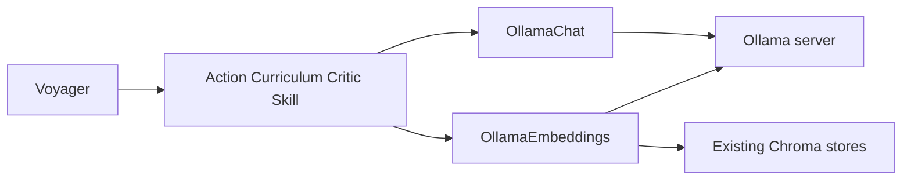

# Migrate Voyager LLM calls from OpenAI to Ollama

## Decisions

- Remove OpenAI. No provider switch and no API key.
- Chat and embeddings both use one Ollama server, default `http://127.0.0.1:11434`.
- Default chat model for every agent: `qwen2.5-coder:7b` (one resident model, so Ollama does not reload weights between action, curriculum, critic, and skill calls). Each agent model name stays overridable.
- Default embedding model: `nomic-embed-text`.
- Keep LangChain message types and Chroma `0.3.29`. Talk to Ollama with `requests`, which is already a dependency. A newer `langchain-ollama` plus a Chroma upgrade would invalidate the on-disk vector stores and the unpinned LangChain imports this repo still uses (`langchain.schema`, `langchain.vectorstores.Chroma`).

## Current wiring

[`voyager/voyager.py`](voyager/voyager.py) requires `openai_api_key`, sets `OPENAI_API_KEY`, and constructs four agents. Those agents construct `ChatOpenAI` in [`voyager/agents/action.py`](voyager/agents/action.py), [`voyager/agents/critic.py`](voyager/agents/critic.py), [`voyager/agents/curriculum.py`](voyager/agents/curriculum.py), and [`voyager/agents/skill.py`](voyager/agents/skill.py). Curriculum and skill search use `OpenAIEmbeddings()` with Chroma. Bundled libraries under `skill_library/trial*` are OpenAI vectors. Prompts, code parsing, and JSON parsing stay as they are.

## Client

Add [`voyager/llm.py`](voyager/llm.py) with two callables and factory functions the agents use.

- `OllamaChat` posts to `/api/chat` with `stream: false` and options `temperature` and `num_ctx`. Map `SystemMessage`, `HumanMessage`, and `AIMessage` to `system`, `user`, and `assistant`. Return `AIMessage`. Set `self.model_name` to the Ollama model name so the action agent’s existing check still includes `useChest` and `mineflayer` (those are omitted only when the name is `gpt-3.5-turbo`).
- Default `num_ctx` is `8192`. Ollama’s own default (often 2048 or 4096) would truncate the action prompt: the template plus control primitives is already several thousand tokens before observations and retrieved skills. `8192` matches the GPT-4 window this code was written for.
- `OllamaEmbeddings.embed_query` / `embed_documents` call `/api/embed`. If that route is missing, fall back to `/api/embeddings`. Chroma only needs those two methods.
- Connection failures and “model not found” responses raise a `RuntimeError` that names the base URL and the model to pull. Do not send `format: json`: the action agent must return JavaScript, the curriculum agent returns `Task:` lines, and only the critic returns JSON. [`voyager/utils/json_utils.py`](voyager/utils/json_utils.py) already extracts a JSON object from surrounding text.

## Agent and constructor changes

In [`voyager/voyager.py`](voyager/voyager.py):

- Replace `openai_api_key` with `ollama_base_url`.
- Rename `openai_api_request_timeout` to `llm_request_timeout` and keep the `240` second default.
- Add `ollama_embedding_model_name="nomic-embed-text"` and `llm_num_ctx=8192`.
- Default `action_agent_model_name`, `curriculum_agent_model_name`, `curriculum_agent_qa_model_name`, `critic_agent_model_name`, and `skill_manager_model_name` to `qwen2.5-coder:7b`.
- Stop writing `OPENAI_API_KEY`.
- Pass base URL, timeout, and `num_ctx` into every agent, and the embedding model into curriculum and skill.

Each agent replaces `ChatOpenAI(...)` with the chat factory. Skill and curriculum replace `OpenAIEmbeddings()` with the embedding factory. Leave prompt rendering, retries, and parsing alone.

## Rebuild indexes that were embedded with OpenAI

Chroma collections in an existing checkpoint or in `skill_library/trial*` have the same count as `skills.json`, so today’s length assertion passes, then similarity search fails or returns nonsense because the vectors are a different model’s.

On skill-manager and curriculum init, read a small marker file next to the store (`skill/embedding.json` and `curriculum/embedding.json`) containing the embedding model name.

- Marker matches: open Chroma as today.
- Marker is missing or names another model, and the store directory is non-empty: delete that store directory, create a new Chroma collection, re-embed from data already on disk, write the marker, and persist.
  - Skills: `skills.json` descriptions, ids and metadata `name` set to the program name (same as `add_new_skill`).
  - Curriculum: one document per key in `qa_cache.json`.
- Fresh run with an empty store: write the marker and keep the existing empty-collection assertion.

The QA near-duplicate cutoff (`score < 0.05` in `run_qa`) stays. It means “almost the same question” under L2. Revisit it only if `nomic-embed-text` never hits the cache for paraphrases.

Loading a bundled `skill_library/trial*` rewrites that trial’s `vectordb/` the first time. That directory is not usable with the new embedding model.

## Docs and dependencies

- [`requirements.txt`](requirements.txt): remove `openai` and `tiktoken`. Neither is imported by this repo once `ChatOpenAI` is gone. Keep `langchain`, `chromadb==0.3.29`, and `requests`.
- [`README.md`](README.md): replace the API-key setup with `ollama serve`, `ollama pull qwen2.5-coder:7b`, and `ollama pull nomic-embed-text`. Update the three `Voyager(...)` examples. Note that the first load of an old skill library re-embeds it.
- [`FAQ.md`](FAQ.md): replace the GPT-3.5 and API-cost answers with local-model notes: pick a code-capable model, raise `llm_num_ctx` only if the model supports it, raise `llm_request_timeout` on CPU, and keep `skill_manager_retrieval_top_k` small if responses are cut off.

## Verification

Add `tests/test_ollama_llm.py` using the stdlib `unittest` and `unittest.mock` (no new test dependency, no live server):

- Role mapping and `num_ctx` / `temperature` are sent to `/api/chat`.
- The returned body becomes an `AIMessage`.
- A connection error mentions the base URL and model.
- `/api/embed` results are returned as vectors, and a 404 on that route falls back to `/api/embeddings`.

No Minecraft or Ollama process is required for that test. A live generation check is a manual step after the models are pulled.
